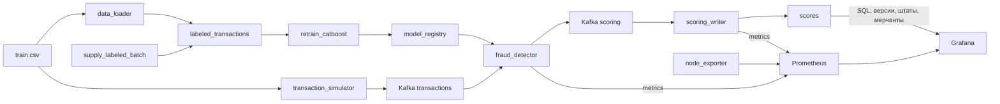
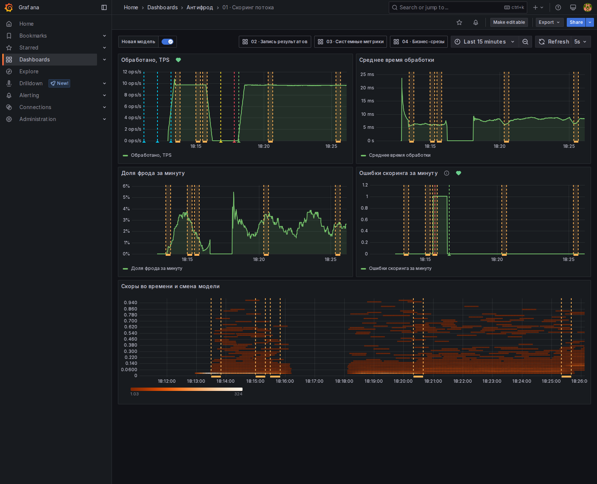
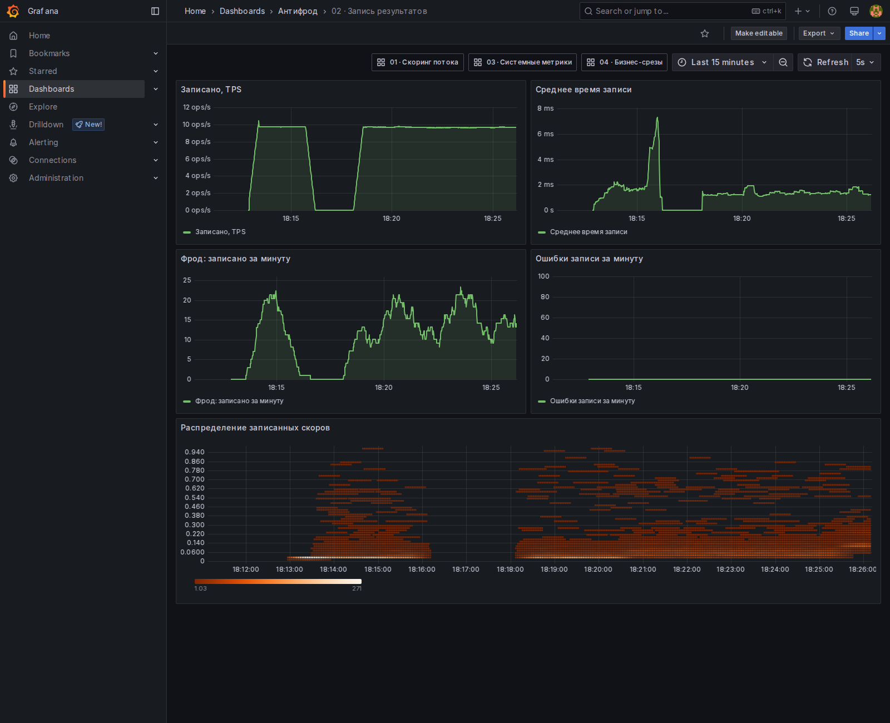
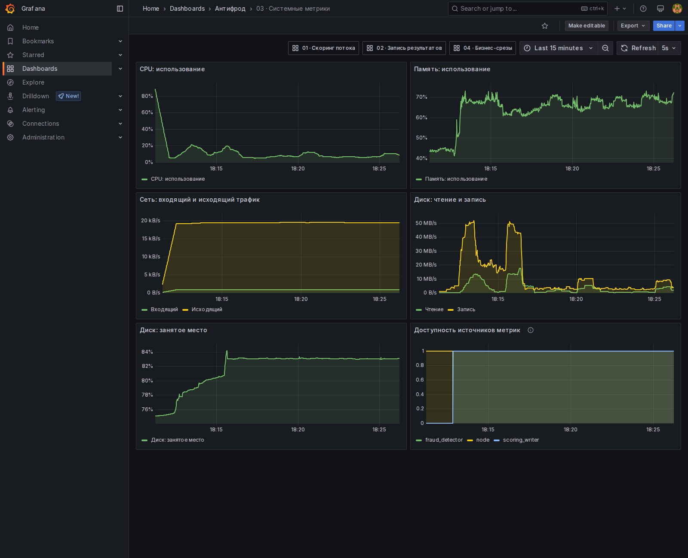
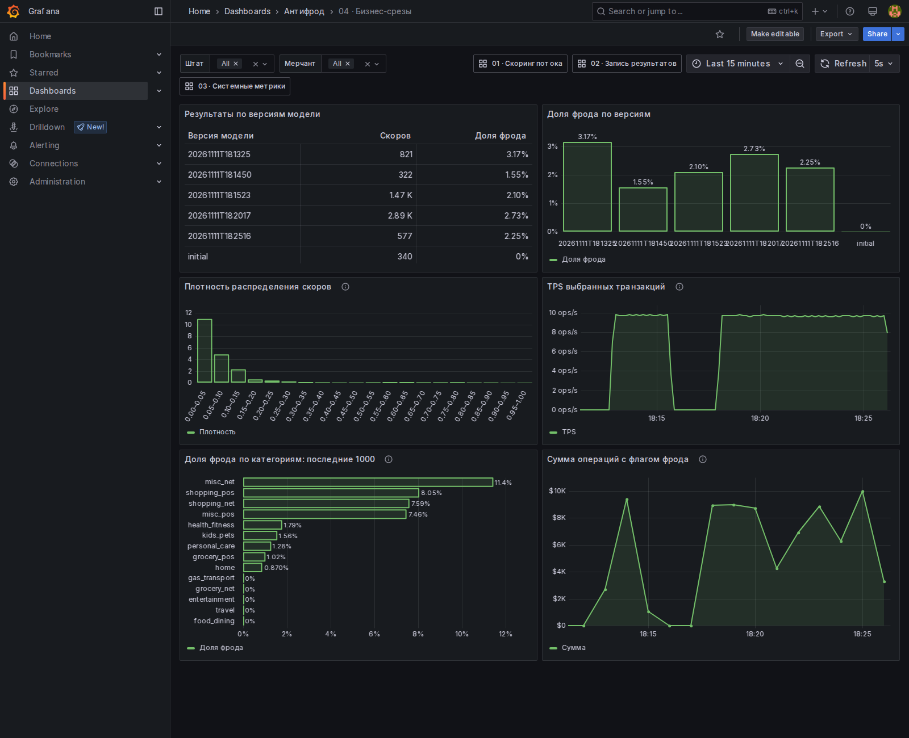
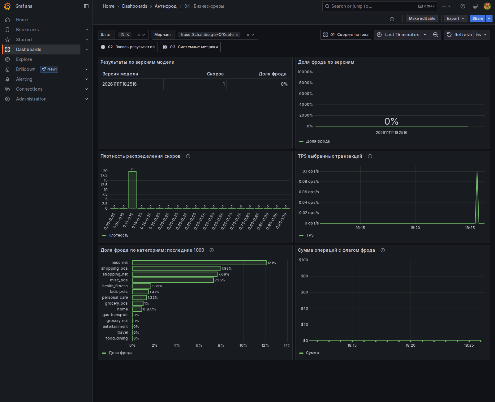
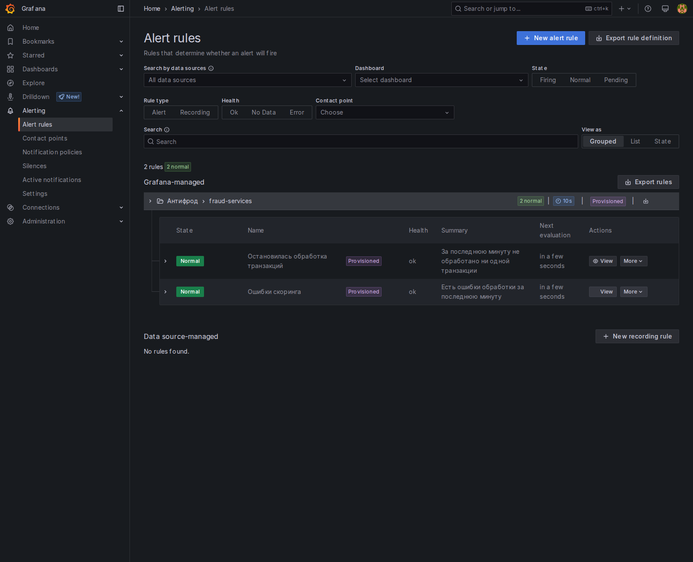

# Антифрод: поток транзакций, скоринг и переобучение

Учебный проект обнаружения мошеннических транзакций. Kafka несёт непрерывный поток событий, CatBoost скорит их текущей моделью, а Airflow по расписанию дописывает размеченные месяцы и переобучает модель. Prometheus и Grafana показывают скорость обработки, распределение скоров и смену версии модели. Бизнес-срезы Grafana получает напрямую из PostgreSQL.

Датасет можно найти [здесь](https://www.kaggle.com/competitions/teta-ml-1-2025/data). В этом занятии используется файл `train.csv` из каталога практики занятия 07. Путь задаётся переменной `TRAIN_DATA_CSV`.

---

## Архитектура



| Сервис | Описание |
|--------|----------|
| **Kafka** | Шина сообщений между симулятором потока, скорингом и записью результатов |
| **Zookeeper** | Управление кластером Kafka |
| **Kafka UI** | Просмотр топиков `transactions` и `scoring` |
| **transaction_simulator** | Бесконечно шлёт в `transactions` случайные строки CSV. У каждой новый `transaction_id` и `transaction_time`, равный текущему моменту, формат `YYYY-MM-DD HH:MM` |
| **fraud_detector** | Препроцессинг и инференс CatBoost. Перед каждым сообщением читает `/models/latest.txt` и подхватывает `my_catboost_<версия>.cbm` без перезапуска |
| **scoring_writer** | Читает топик `scoring` и пишет `score`, `fraud_flag` и `model_version` в PostgreSQL |
| **PostgreSQL** | Витрина `labeled_transactions`, состояние окна `training_state` и таблица `scores` |
| **data_loader** | При старте один раз загружает весь CSV в витрину и собирает исходное окно обучения: январь–март 2019 |
| **airflow** | Два DAG каждые 5 минут: поставка нового размеченного месяца и переобучение CatBoost |
| **Prometheus** | Собирает метрики `fraud_detector` (`:8000`), `scoring_writer` (`:8001`) и Node Exporter раз в секунду |
| **Grafana** | Четыре дашборда: скоринг, запись в БД, системные метрики и бизнес-срезы. Два алерта. Смена версии модели отмечена интервалом около 30 секунд с именем новой версии |
| **Node Exporter** | Системные метрики хоста контейнеров: CPU, память, сеть, диск |

Общий том `model_registry` смонтирован в Airflow как `/opt/airflow/models` и в `fraud_detector` как `/models`. Логика задач вынесена в `pipeline/`. Файлы в `dags/` только связывают задачи.

---

## Структура проекта

```
.
├── fraud_detector/           # Онлайн-скоринг
├── transaction_simulator/    # Непрерывная поставка транзакций в Kafka
├── scoring_writer/           # Запись скоров в PostgreSQL
├── data_loader/              # Первичная загрузка размеченной витрины
├── dags/
│   ├── retrain_catboost.py   # DAG переобучения
│   └── supply_labeled_batch.py
├── pipeline/
│   ├── db.py                 # Подключение к витрине и training_state
│   ├── retrain/              # Функции задач переобучения
│   └── supply/               # Функции задач поставки месяца
├── airflow/                  # Образ Airflow с CatBoost
├── prometheus/prometheus.yml # Источники метрик
├── grafana/                  # Datasource, provisioning и дашборды
├── docker-compose.yaml
├── .env.example
└── README.md
```

---

## Что происходит после запуска

1. `data_loader` копирует `TRAIN_DATA_CSV` в `labeled_transactions` и сохраняет окно января–марта 2019. Повторный старт без `down -v` витрину не перезаливает.
2. `transaction_simulator` каждые 0.1 секунды отправляет в Kafka случайную транзакцию с текущим временем.
3. `fraud_detector` скорит поток моделью из общего каталога. До первого переобучения версия — `initial`: в каталог копируется модель из образа.
4. `scoring_writer` складывает результат в `scores`, включая `model_version`.
5. DAG `supply_labeled_batch` каждые 5 минут берёт из витрины 100 тысяч случайных строк, переносит их время в следующий календарный месяц и дописывает батч. Наблюдения старше трёх лет относительно самого нового месяца удаляются.
6. DAG `retrain_catboost` каждые 5 минут забирает следующий месяц витрины, начиная с апреля 2019, сдвигает трёхмесячное окно, учит CatBoost и публикует `my_catboost_<timestamp>.cbm`.

Переобучение и поставка идут по разным указателям месяца. `retrain_catboost` читает исторические месяцы с апреля 2019. `supply_labeled_batch` каждый раз создаёт месяц после максимальной даты витрины, первый такой месяц — апрель 2020. Окно обучения ещё долго не доходит до этих батчей, и очистка трёх лет его не затрагивает.

Оба DAG можно запустить вручную в Airflow, не дожидаясь расписания. Если очередного месяца в витрине ещё нет, задачи переобучения помечаются как skipped.

---

## Технологии

- **Python 3.11**
- **ML**: CatBoost, pandas, numpy
- **Kafka**: потоковая обработка данных
- **PostgreSQL**: витрина размеченных данных и результаты скоринга
- **Airflow 2.10**: поставка месячных батчей и переобучение модели
- **Prometheus / Grafana**: сбор и визуализация метрик скоринга и хоста
- **Docker / Docker Compose**: оркестрация микросервисов

---

## Как запустить проект

### 1. Клонируйте репозиторий

```bash
git clone https://github.com/andreykil/mlops-hw5.git
cd mlops-hw5
```

### 2. Создайте `.env` файл

```bash
cp .env.example .env
```

В `TRAIN_DATA_CSV` укажите путь к размеченному `train.csv` на вашей машине.

### 3. Запустите контейнеры

```bash
docker compose up -d --build
```

Для локального запуска желательно выделить Docker 8 ГБ памяти: одновременно работают Kafka, Airflow и обучение модели.

Нужны [Docker](https://docs.docker.com/engine/install/) и Docker Compose. Первый запуск скачивает образы и загружает витрину, это занимает несколько минут.

## Доступные сервисы

| Сервис | URL |
|--------|-----|
| **Kafka UI** | http://localhost:8080 |
| **Airflow** | http://localhost:8081 (`admin` / `admin`) |
| **PostgreSQL** | `localhost:5432`, база `fraud_db` |
| **Prometheus** | http://localhost:9090 |
| **Grafana** | http://localhost:3000 (`admin` / `admin`) |

При первом входе Grafana предлагает сменить пароль. Кнопка Skip оставляет `admin` / `admin`.

Пользователь и пароль Postgres задаются в `.env` (`fraud_user` / `fraud_pass` в шаблоне).

Посмотреть витрины из контейнера:

```bash
docker compose exec postgres psql -U fraud_user -d fraud_db
```

---

## Таблицы PostgreSQL

Таблица `scores`:

| Поле | Тип | Описание |
|------|-----|----------|
| id | SERIAL | Уникальный ID |
| transaction_id | TEXT | Идентификатор транзакции |
| score | FLOAT | Вероятность мошенничества, порог 0.5 |
| fraud_flag | INT | 1, если score больше 0.5, иначе 0 |
| model_version | TEXT | Версия CatBoost, которая посчитала скор |
| us_state, merch, cat_id | TEXT | Штат, мерчант и категория исходной транзакции |
| amount | DOUBLE PRECISION | Сумма операции |
| scored_at | TIMESTAMPTZ | Точное время скоринга в UTC, используется для SQL-графиков |
| created_at | TIMESTAMP | Время записи |

`labeled_transactions` — витрина размеченных транзакций. `training_state` хранит границы трёхмесячного окна обучения и месяц следующего батча.

Последние скоры:

```sql
SELECT transaction_id, score, fraud_flag, model_version, created_at
FROM scores
ORDER BY created_at DESC
LIMIT 20;
```

Модели, которые опубликовал DAG:

```bash
docker compose exec airflow ls -la /opt/airflow/models
```

---

## Как смотреть демонстрацию

1. В Kafka UI топик `transactions` пополняется каждые 0.1 секунды, топик `scoring` — ответами модели.
2. В Airflow откройте `supply_labeled_batch` и `retrain_catboost`. Кнопка Trigger запускает прогон сразу.
3. После публикации модели новые сообщения в `scores` получают свежий `model_version`.
4. В Grafana откройте «01 · Скоринг потока». На графике распределения скоров смена модели видна как отметка примерно в 30 секунд с подписью версии. «03 · Системные метрики» показывает CPU, память, сеть и диск.

### Очистка

`docker compose down -v` удаляет контейнеры вместе с витриной, окном обучения, реестром моделей, состоянием Airflow и томами Prometheus и Grafana. Следующий запуск снова загрузит CSV.


## Мониторинг

Prometheus собирает метрики скоринга, записи результатов и Node Exporter раз в секунду.
Источники Prometheus и PostgreSQL, дашборды и алерты Grafana подключаются автоматически.
После запуска дождитесь 30–60 секунд потока, чтобы графики заполнились.

### Дашборды

Дашборды находятся в папке «Антифрод» и обновляются раз в 5 секунд.

| Дашборд | Содержимое |
|---|---|
| [01 · Скоринг потока](http://localhost:3000/d/fraud-scoring) | TPS, время обработки, доля фрода, ошибки, распределение скоров и смена модели |
| [02 · Запись результатов](http://localhost:3000/d/fraud-writer) | Скорость и время записи, число фродовых транзакций, ошибки и распределение скоров |
| [03 · Системные метрики](http://localhost:3000/d/fraud-system) | CPU, память, сеть и диск |
| [04 · Бизнес-срезы](http://localhost:3000/d/fraud-business) | Число скоров и доля фрода по версиям модели, плотность скоров и TPS с фильтрами `us_state` и `merch`, доля фрода по категориям, сумма подозрительных операций |

Бизнес-срезы читаются из PostgreSQL. Фильтры штата и мерчанта поддерживают несколько
значений и All. Панель категорий считает средний `fraud_flag` по `cat_id` среди последних
1000 записей всего потока, независимо от фильтров и периода. Дополнительный график суммы
операций с флагом фрода помогает видеть денежные всплески. Флаг фрода — предсказание модели.

### Метрики

Скоринг: http://localhost:8000/metrics. Запись результатов: http://localhost:8001/metrics.
В http://localhost:9090/targets все три источника должны быть UP.

| Метрика | Назначение |
|---|---|
| `transactions_total` | Число обработанных транзакций |
| `transaction_processing_seconds_sum`, `_count` | Время и число попыток обработки; используются для среднего времени |
| `fraud_score_bucket`, `_sum`, `_count` | Гистограмма скоров |
| `fraud_transactions_total` | Число транзакций с флагом фрода; используется для доли за минуту |
| `fraud_ratio` | Доля фрода за всё время работы процесса |
| `transaction_processing_errors_total` | Новая метрика для обнаружения проблем входных сообщений или модели. Смотреть график «Ошибки скоринга за минуту» на дашборде 01 |
| `model_version_updates_total{version="…"}` | Смена модели; используется для отметки новой версии |
| `scorings_total` | Число записанных скоров |
| `scoring_db_write_seconds_sum`, `_count` | Время и число попыток записи |
| `fraud_detected_total` | Число записанных результатов с флагом фрода |
| `scoring_fraud_score_bucket`, `_sum`, `_count` | Гистограмма записанных скоров |
| `scoring_write_errors_total` | Ошибки записи |
| `node_cpu_seconds_total`, `node_memory_*`, `node_network_*`, `node_disk_*`, `node_filesystem_*` | CPU, память, сеть и диск |
| `up` | Доступность источника метрик |

### Проверка потока и смены модели

1. Откройте дашборды 01 и 02: TPS должен быть больше нуля, счётчики на `/metrics` — расти
   при повторном открытии. На дашборде 04 выбор штата и мерчанта должен менять плотность и TPS.
2. Запустите переобучение в Airflow или командой:

   ```bash
   docker compose exec airflow airflow dags trigger retrain_catboost
   ```

3. После успешной задачи `publish_model` на дашборде 01 появится оранжевая отметка
   «Модель <версия>» длительностью около 30 секунд, а на дашборде 04 — новая версия.
   Контейнер скоринга перезапускать не нужно. Первая загрузка `initial` не считается сменой.

### Алерты

Правила из `grafana/provisioning/alerting/rules.yaml` загружаются при старте.
Откройте http://localhost:3000/alerting/list и раскройте группу «Антифрод → fraud-services».
Правила проверяются каждые 10 секунд.

| Правило | Условие |
|---|---|
| Остановилась обработка транзакций | Менее 1 транзакции за последнюю минуту в течение еще 1 минуты; недоступность скорера или отсутствие метрик тоже вызывают алерт |
| Ошибки скоринга | Более 0 ошибок обработки за последнюю минуту, без дополнительной выдержки |

Для проверки остановки дождитесь обычного потока и остановите симулятор:

```bash
docker compose stop transaction_simulator
```

После обработки очереди Kafka и примерно двух минут ожидания алерт станет Firing.
Верните поток командой `docker compose start transaction_simulator`: алерт вернется в Normal.

Для проверки ошибок отправьте некорректное сообщение:

```bash
printf '%s\n' '{"transaction_id":"demo-invalid","data":{}}' | \
  docker compose exec -T kafka kafka-console-producer \
    --bootstrap-server kafka:9092 --topic transactions
```

На следующем цикле оценки алерт станет Firing, а после выхода ошибки из минутного
окна вернётся в Normal. Скорер продолжит обрабатывать остальные сообщения.

## Скриншоты

В [screenshots/](screenshots/) находятся скриншоты Grafana.

<details>
<summary>Посмотреть дашборды и алерты</summary>

**Скоринг потока и смена модели**



**Запись результатов**



**Системные метрики**



**Бизнес-срезы**



**Фильтры по штату и мерчанту**



**Алерты**



</details>
